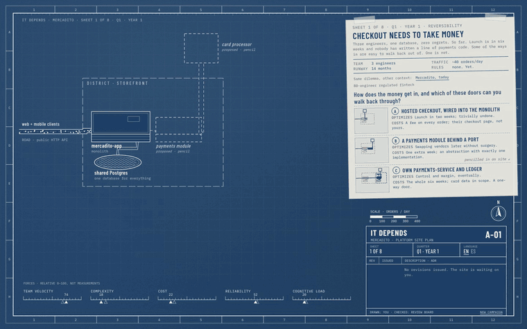
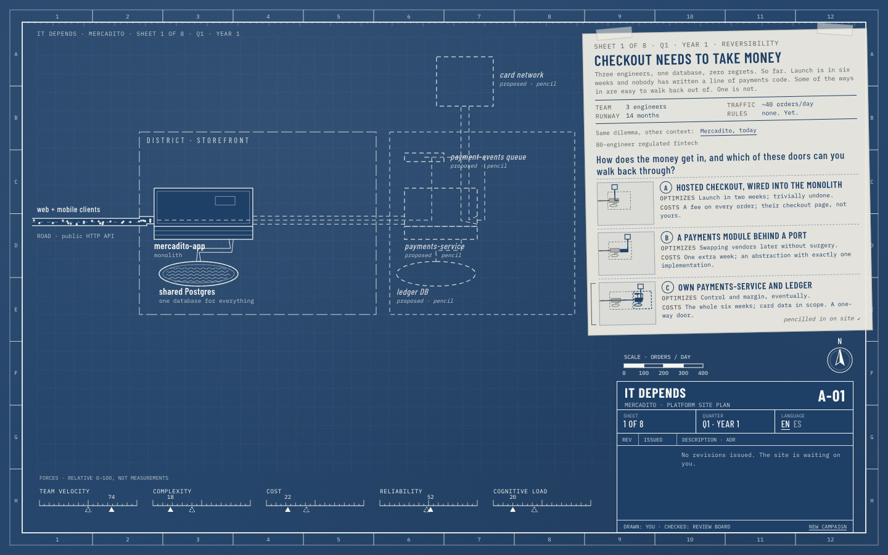
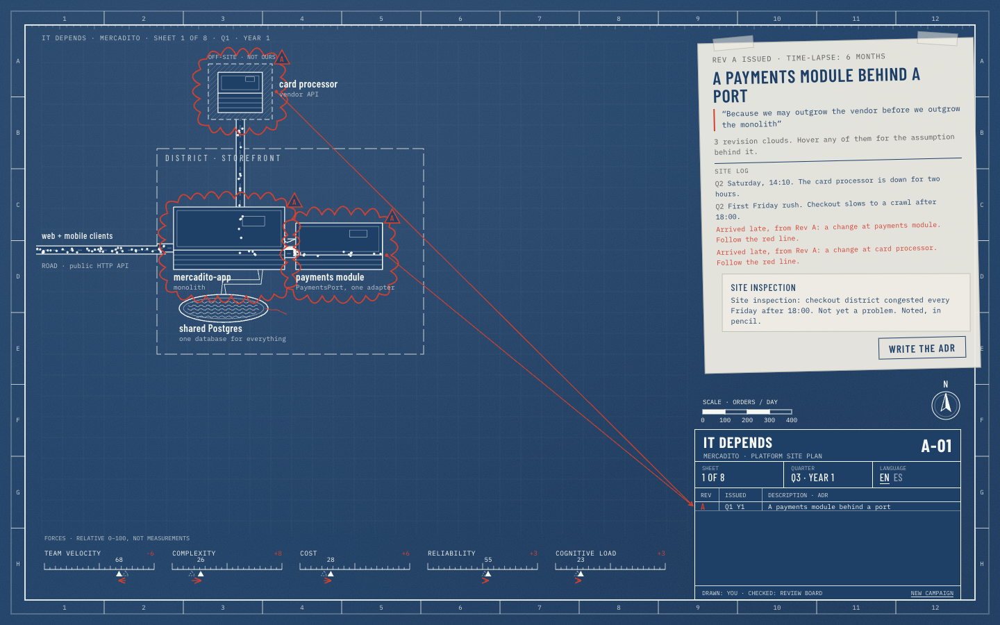
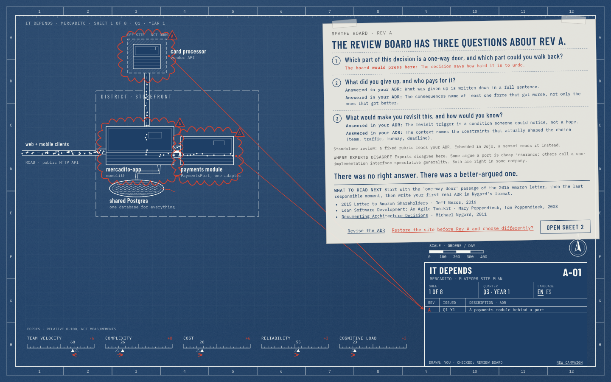
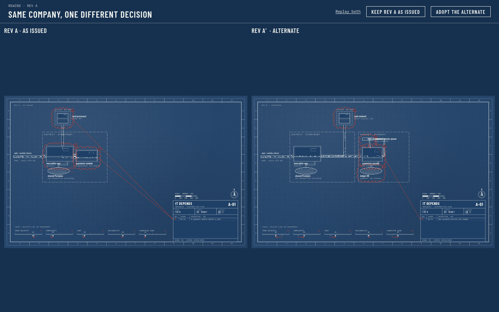

# It Depends

An interactive course on software architecture decision-making, played as a campaign.

You are the architect of **Mercadito**, a marketplace with payments, for three years: from three founders and one database to an 80-engineer regulated fintech. Its system is drawn as a living city on cyanotype blueprint paper. You make a decision, the drawing time-lapses forward, the city grows, and red-pencil revision clouds sketch themselves around what changed. Some consequences arrive late, and a red leader line points back to the revision that caused them. The title block in the corner is your ADR log.

The course never rewards a single correct answer. It rewards knowing which forces matter in which context, and being able to justify, and revisit, a decision.



## What you do on each sheet

1. **Read the briefing** on a vellum overlay: team, traffic, runway, regulation, and a dilemma with three options. Each option says what it optimizes and what it costs.
2. **Hover an option** to see it pencilled onto the city as dashed linework, with ghost markers on the force gauges. Toggle the context (Mercadito today vs an 80-engineer regulated fintech) and watch the weights change.
3. **Choose and write one sentence of why.** Issue the revision.
4. **Watch the time-lapse.** Buildings rise floor by floor, traffic thickens and reddens where load passes capacity, cracks spread from shared reservoirs, clouds draw around the consequences.
5. **Hover anything** to read the assumption and the source behind it. Click a building to zoom into its district and open a section drawing of the service.
6. **Write the ADR** (context, decision, consequences, what you gave up, when to revisit). The review board asks three questions. Standalone, a deterministic rubric reads it; inside Dojo, a sensei can.
7. **Rewind** any revision and choose differently: two cities grow side by side, same company, one different decision.

| | |
|---|---|
|  |  |
|  |  |

## Run it

```bash
npm install
```

```bash
npm run dev
```

Checks, as CI runs them:

```bash
npm run typecheck && npm run lint && npm run validate:content && npm run check:i18n && npm test
```

```bash
npm run e2e
```

The build writes `dist/` with relative paths (it works from any GitHub Pages path and inside an iframe) and generates `scroll.json`, the Dojo manifest.

## How it is built

- `src/engine`: a pure, deterministic simulation. Same decisions and seed, same city. No LLM inside. [ADR 1](docs/adr/0001-deterministic-simulation.md)
- `src/content`: the company, the sources and one JSON file per chapter. Every effect carries a written assumption and a source, or the build fails. [ADR 2](docs/adr/0002-content-as-data.md), [content guide](docs/CONTENT-GUIDE.md)
- `src/city`: layout and the PixiJS renderer, fed only by engine snapshots. [ADR 3](docs/adr/0003-pixi-city-react-overlays.md), [ADR 5](docs/adr/0005-stable-layout-and-upserts.md)
- `src/i18n`: English (source) and Spanish (Mexico). Adding a locale is adding a folder. CI fails on any missing key.
- `src/host`: the course manifest and a `HostBridge` with a standalone adapter and an embedded one that speaks Dojo's scroll protocol v0. [ADR 4](docs/adr/0004-dojo-scroll-protocol.md)
- `src/ui`: React screens and vellum overlays. No verdicts anywhere. [ADR 6](docs/adr/0006-review-without-verdicts.md)

The overall plan is in [docs/PLAN.md](docs/PLAN.md).

## Sources

The course paraphrases, never reproduces: *Fundamentals of Software Architecture* and *Software Architecture: The Hard Parts* (Richards, Ford et al.), *A Philosophy of Software Design* (Ousterhout), *Choose Boring Technology* (McKinley), *Team Topologies* (Skelton, Pais), *Building Evolutionary Architectures*, Michael Nygard's ADRs, one-way and two-way doors, and more listed in `src/content/sources.json`. Where experts disagree, the chapter says so.

## License

MIT
