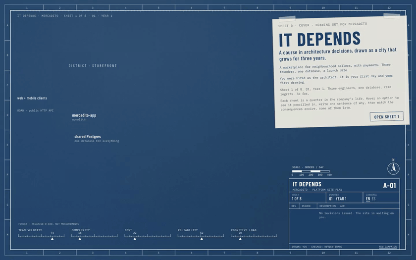

# It Depends

[](https://github.com/rodacato/it-depends/actions/workflows/ci.yml)
[](https://github.com/rodacato/it-depends/actions/workflows/site-pages.yml)
[](LICENSE)

**Play it in your browser: [rodacato.github.io/it-depends](https://rodacato.github.io/it-depends/)**

An interactive course on software architecture decision-making, played as a campaign.

You are the architect of **Mercadito**, a marketplace with payments, for three and a half years: from three founders and one database to a regulated fintech of nearly 80 engineers. Its system is drawn as a living city on cyanotype blueprint paper. You make a decision, the drawing time-lapses forward, the city grows, and red-pencil revision clouds sketch themselves around what changed. Some consequences arrive late, and a red leader line points back to the revision that caused them. The title block in the corner is your ADR log.

The course never rewards a single correct answer. It rewards knowing which forces matter in which context, and being able to justify, and revisit, a decision.



[Full recording (MP4)](docs/media/demo.mp4)

## What you do on each sheet

Eight sheets, one per decision, in English and Spanish (Mexico).

1. **Read the briefing** on a vellum overlay: team, traffic, runway, regulation, and a dilemma with three options (four in the finale). Each option says what it optimizes and what it costs.
2. **Hover an option** to see it pencilled onto the city as dashed linework, with ghost markers on the force gauges. On most sheets, toggle the context (Mercadito today vs an 80-engineer regulated fintech) and watch the weights change.
3. **Choose and write one sentence of why.** Issue the revision.
4. **Watch the time-lapse.** Buildings rise floor by floor, traffic thickens and reddens where load passes capacity, cracks spread from shared reservoirs, clouds draw around the consequences.
5. **Hover anything** to read the assumption and the source behind it. Click a building to zoom into its district and open a section drawing of the service.
6. **Write the ADR** (context, decision, consequences, what you gave up, when to revisit). The review board asks three questions and a deterministic rubric reads it, standalone and inside Dojo. The rubric checks the shape of the argument (keywords, length, a revisit condition), not whether it is right, and says so on screen. When Dojo offers a sensei, its notes will appear alongside the board, never instead of it.
7. **Rewind** any revision and choose differently: two cities grow side by side, same company, one different decision.

| | |
|---|---|
|  |  |
|  |  |

## Run it

Needs Node 22.22 or newer (or 24.15+) and npm.

```bash
npm install
npm run dev        # http://localhost:5173
```

The build writes `dist/` with relative paths (it works from any GitHub Pages path and inside an iframe) and generates `scroll.json`, the Dojo manifest. `npm run preview` serves it.

## Checks

| Script | What it checks | In CI |
|---|---|---|
| `npm run typecheck` | `tsc -b --noEmit` | every push and PR |
| `npm run lint` | ESLint; the engine may not import DOM or UI | every push and PR |
| `npm run validate:content` | schema, sources, assumptions, every option valid on every reachable site | every push and PR, and before every build |
| `npm run check:i18n` | missing, extra, empty or placeholder-mismatched keys | every push and PR |
| `npm test` | Vitest: engine, rubric, layout, bridge, manifest | every push and PR |
| `npm run build` | the full build plus the manifest | every push and PR |
| `npm run e2e:smoke` | one Playwright test: the course embedded in a Dojo-like host | every PR |
| `npm run e2e` | everything: the main flow in English and Spanish, reduced motion, all eight sheets, the section drawing, the embedded host | nightly and on demand |
| `npm run demo` | records `docs/media/demo.mp4` and `demo.gif` from the production build (needs `ffmpeg`) | no |

Install the browser once before the first e2e run: `npx playwright install --with-deps chromium`.

## Architecture

Dependencies point one way: `content` and `i18n` feed `engine`; `city` and `ui` only read engine snapshots and never compute outcomes; `host` sits at the edge.

- `src/engine`: a pure, deterministic simulation. Same decisions and seed, same city. No LLM inside. [ADR 1](docs/adr/0001-deterministic-simulation.md)
- `src/content`: the company, the sources and one JSON file per chapter. Every effect carries a written assumption and a source, or the build fails. [ADR 2](docs/adr/0002-content-as-data.md), [content guide](docs/CONTENT-GUIDE.md)
- `src/city`: layout and the PixiJS renderer, fed only by engine snapshots. [ADR 3](docs/adr/0003-pixi-city-react-overlays.md), [ADR 5](docs/adr/0005-stable-layout-and-upserts.md)
- `src/i18n`: English (source) and Spanish (Mexico). Adding a locale is adding a folder. CI fails on any missing key.
- `src/host`: the course manifest and a `HostBridge` with a standalone adapter and an embedded one that speaks Dojo's scroll protocol v0. [ADR 4](docs/adr/0004-dojo-scroll-protocol.md)
- `src/ui`: React screens and vellum overlays. No verdicts anywhere. [ADR 6](docs/adr/0006-review-without-verdicts.md)

The overall plan is in [docs/PLAN.md](docs/PLAN.md).

## Embedding in Dojo

[Dojo](https://github.com/rodacato/dojo) is a self-hosted practice space for developers that embeds courses like this one in an iframe. It Depends speaks Dojo's scroll protocol v0. The build generates `scroll.json` from the content: one unit per chapter, locales `en` and `es-MX`. Framed with `?host=<origin>`, the course runs a `hello`/`init` handshake with a nonce, talks only to that origin and its parent window, validates every message, reports `progress` and `complete` per chapter, and follows the host's locale and theme. With no answer from the host in 3 seconds it runs standalone. Progress it reports is self-reported. See [ADR 4](docs/adr/0004-dojo-scroll-protocol.md).

## Contributing

A chapter is one JSON file in `src/content/chapters/` plus one text file per locale in `src/i18n/locales/<locale>/`; the engine and the UI never change. Every option must hurt somewhere, and every effect needs a falsifiable assumption and a source from `src/content/sources.json`. A new language is a new folder with the same files as `en/`. Read the [content guide](docs/CONTENT-GUIDE.md), then check your work with `npm run validate:content`, `npm run check:i18n` and `npm test` before opening a pull request.

## Sources

The course paraphrases, never reproduces: *Fundamentals of Software Architecture* and *Software Architecture: The Hard Parts* (Richards, Ford et al.), *A Philosophy of Software Design* (Ousterhout), *Choose Boring Technology* (McKinley), *Team Topologies* (Skelton, Pais), *Building Evolutionary Architectures*, Michael Nygard's ADRs, one-way and two-way doors, and more listed in `src/content/sources.json`. Where experts disagree, the chapter says so.

## License

MIT, see [LICENSE](LICENSE).
